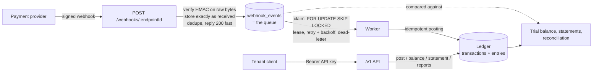

# Ledger Engine

A multi-tenant, double-entry financial ledger with a signed-webhook ingestion pipeline.
Built with PostgreSQL, Prisma, Fastify and TypeScript.

Money systems fail in boring ways: a retried request posts twice, two withdrawals race and
overdraw an account, one tenant reads another's data, a webhook is processed twice. This project
makes each of those **impossible at the database level**, not just unlikely in application code,
and proves it with tests.

## How it fits together



## What it guarantees, and where it is enforced

| Guarantee | Enforced by |
|---|---|
| Every transaction balances (debits = credits, per currency) and has 2+ entries | Deferred constraint trigger, checked at `COMMIT` |
| History is append-only; corrections are reversing transactions | Triggers block `UPDATE`/`DELETE`/`TRUNCATE`; the app role has no such privileges |
| An entry's currency matches its account; no cross-tenant references | Composite foreign keys `(tenant_id, account_id, currency)` |
| Tenants cannot see each other's data | Row-level security, `FORCE`d, tenant set per DB transaction; app connects as a non-owner role |
| A retried request never double-posts | Idempotency key per tenant + request fingerprint; concurrent duplicates resolve via the unique index |
| Accounts that forbid it cannot go negative, even under concurrency | Per-account advisory locks (taken in sorted order) around the balance check |
| Webhooks are authentic | HMAC verified over the **raw request bytes** with a timing-safe compare, per-endpoint secret |
| Webhooks are processed at most once into the ledger | `(tenant, provider, event id)` uniqueness + idempotent posting key `webhook:<event id>` |
| The worker cannot tamper with evidence | Separate DB role; it can update only status columns, never `raw_body`/`payload` |
| API keys are never stored | Only the SHA-256 hash; lookup through one narrow `SECURITY DEFINER` function |

## Key design decisions

- **Integer minor units (`bigint`)**, never floats. `₦250.00` is `25000`.
- **Postgres as the queue** (`FOR UPDATE SKIP LOCKED`) instead of Redis: the event row and the
  ledger posting live in the same database, so there is one less system to keep consistent.
- **Acknowledge fast, process later.** The webhook endpoint only verifies and stores. A slow or
  failing posting can never make the provider time out and retry.
- **Reversals, not edits.** A mistake is fixed by posting the opposite transaction; the audit
  trail stays intact.
- **SQL files are the source of truth.** Prisma cannot see RLS policies or triggers, so
  `migrations/*.sql` define the schema and `prisma db pull` mirrors it for types.

## Run it locally

Requires Node 20+ and PostgreSQL 15+.

```bash
npm install
cp .env.example .env            # then fill in the three connection strings

# create the database, then apply the migrations in order (psql or any SQL client):
#   migrations/001_init.sql  002_webhooks.sql  003_api_keys.sql  004_roles_utc.sql
# and give the two app roles passwords:
#   alter role ledger_app with password '...';  alter role ledger_worker with password '...';

npx prisma db pull  --config prisma7.config.ts
npx prisma generate --config prisma7.config.ts

npm test        # full suite
npm run demo    # end-to-end walkthrough with printed reports
npm start       # API + webhook receiver on :3000
npm run worker  # webhook processor (run alongside the server)
```

## API

All `/v1` routes need `Authorization: Bearer <api key>`. The tenant comes only from the key.

| Method | Path | Purpose |
|---|---|---|
| `GET` / `POST` | `/v1/accounts` | List / create accounts |
| `POST` | `/v1/transactions` | Post a balanced transaction (idempotent via `idempotencyKey`) |
| `GET` | `/v1/transactions/:id` | One transaction with its entries |
| `GET` | `/v1/accounts/:code/balance` | Current balance |
| `GET` | `/v1/accounts/:code/statement?from&to&limit` | Movements with running balance |
| `GET` | `/v1/reports/trial-balance?asOf` | Totals per account; proves debits = credits |
| `GET` | `/v1/reports/reconciliation` | Re-checks the books and compares postings with provider events |
| `POST` | `/webhooks/:endpointId` | Provider webhooks (signature-verified, no API key) |

Create a tenant and key: `npx tsx scripts/create-tenant.ts "Company"`.
Reconcile from a scheduler: `npx tsx scripts/reconcile.ts <tenant_id>` (non-zero exit on failure).
Re-queue a stuck event: `npx tsx scripts/replay.ts <event_id>`.

## Tests

Tests run against a real PostgreSQL database, because the guarantees live in the database. They cover
unbalanced and empty postings, cross-tenant and cross-currency attempts, concurrent duplicate
requests, concurrent overdrafts, forged and tampered webhooks, duplicate deliveries, retry and
dead-letter behaviour, two workers racing for the same events, API-key isolation and reconciliation.

## Known limits (deliberately out of scope)

- Single currency per transaction line set is balanced per currency, but there is no FX conversion.
- Only two provider adapters (`paystack`, `generic`); new providers implement a small `verify`/`describe` interface.
- The worker maps a payment event to a fixed Cash/Revenue posting; per-tenant mapping rules are the natural next step.
- No admin UI; tenants and API keys are created by script.